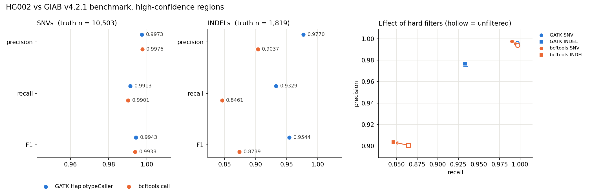
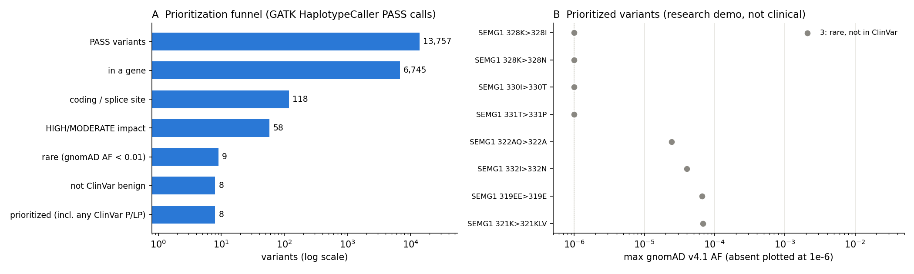
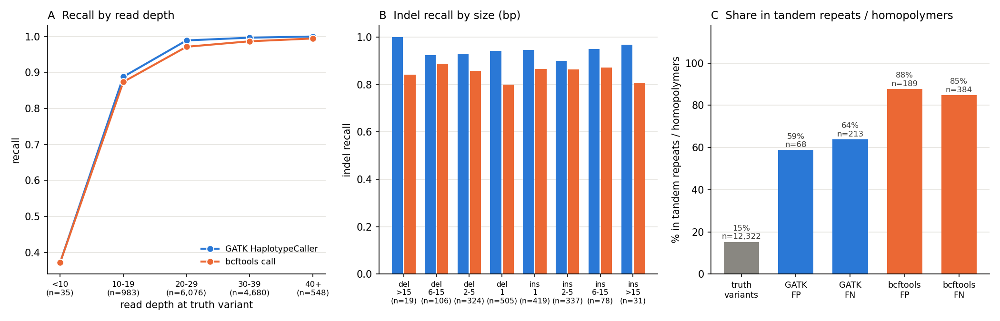
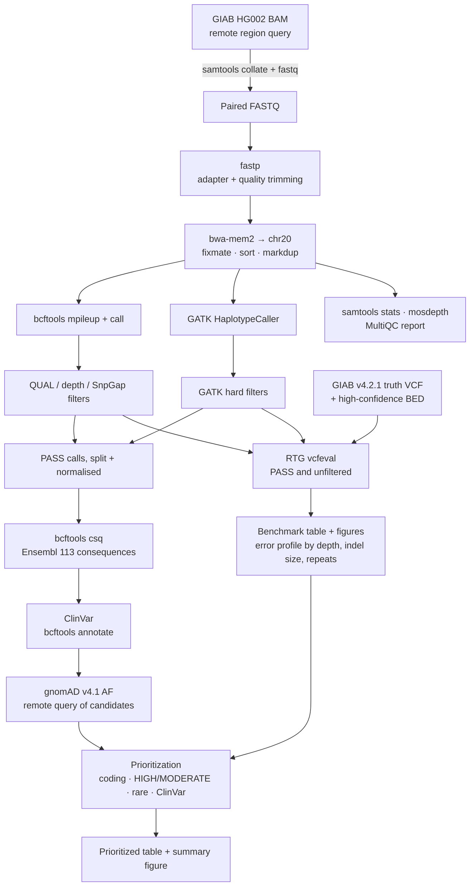

# Germline variant calling, benchmarking and annotation (GIAB HG002)

[](../../actions/workflows/ci.yml)

A small, reproducible Snakemake pipeline that takes whole-genome Illumina reads
from the Genome in a Bottle sample **HG002**, calls germline SNVs and indels with
two callers, benchmarks both against the GIAB truth set, then annotates and
prioritizes variants in clinically relevant genes.

> **Research use only.** The prioritization step demonstrates a filtering
> workflow. It is not a clinical interpretation and makes no ACMG classification.

## Question

How accurately do two common variant callers (**GATK HaplotypeCaller** and
**bcftools**) recover known variants in a well-characterized human genome, and
which variants in clinically relevant genes would be prioritized after annotation?

## Key figures



*Precision, recall and F1 for SNVs and indels against GIAB v4.2.1 within the
high-confidence regions, and how hard filtering moves each caller (right).*



*From all PASS calls to a short list: consequence, impact, gnomAD frequency and
ClinVar status.*

## Results summary

Region chr20:40-50 Mb, HG002 downsampled to **28.7x** mean depth (99.5% of bases
≥10x, 92.3% ≥20x), 99.96% of reads mapped, 1.4% duplicates. Benchmarked inside
9.67 Mb of GIAB high-confidence sequence (10,503 truth SNVs, 1,819 truth indels).
Full numbers: [`results/tables/run_summary.md`](results/tables/run_summary.md).

| Caller (PASS calls) | SNV precision | SNV recall | SNV F1 | Indel precision | Indel recall | Indel F1 |
| --- | --- | --- | --- | --- | --- | --- |
| GATK HaplotypeCaller | 0.9973 | 0.9913 | **0.9943** | 0.9770 | 0.9329 | **0.9544** |
| bcftools call | 0.9976 | 0.9901 | 0.9938 | 0.9037 | 0.8461 | 0.8739 |

- **SNVs: a tie.** Both callers find >99% of truth SNVs with <0.3% false positives.
- **Indels: GATK is clearly better** (F1 0.954 vs 0.874). bcftools makes 4x more
  indel false positives (164 vs 40) and misses more than twice as many (280 vs 122).
  This is the expected advantage of local haplotype re-assembly over a pileup
  model when reads are misaligned around an indel.
- **Errors concentrate in repeats.** Only 15% of truth variants lie in tandem
  repeats or homopolymers, but these hold 59-64% of GATK errors and 85-88% of
  bcftools errors. Outside repeats, GATK indel recall is 0.998. Inside, it is 0.90
  (bcftools: 0.98 vs 0.79).
- **Depth matters below ~20x.** Recall is >0.97 from 20x upwards for both callers.
  It drops to ~0.88 at 10-19x and below 0.5 under 10x (Figure: `figures/error_profile.png`).
- **Hard filters are a trade-off.** They barely change indel results, and they
  slightly *lower* SNV F1 for both callers (GATK 0.9960 → 0.9943), removing more
  true than false SNVs. This is a known weakness of generic single-sample hard filters.



**Prioritization** (GATK, the better call set): 13,757 PASS variants → 118
coding/splice → 58 HIGH/MODERATE impact → 9 rare (max gnomAD v4.1 AF < 1%) →
**8 prioritized**. None of the coding variants has a ClinVar
pathogenic/likely pathogenic or VUS record (40 are ClinVar benign/likely benign,
78 are not in ClinVar), which is what you would expect for a healthy
volunteer in a 10 Mb window.

All 8 shortlisted variants sit within 40 bp of each other in **SEMG1**, inside
a tandem repeat and outside the GIAB benchmark regions. A cluster of "rare"
missense changes and in-frame indels like this is the classic sign of a
repeat-length difference or misalignment, not eight independent rare variants.
The `difficult_region` and `GIAB_status` columns flag this. A real
review would deprioritize or confirm it orthogonally (e.g. long reads or Sanger).
The example shows why annotation-only filtering is not enough without
call-quality context.

## Data

| Data | Source | How it is fetched |
| --- | --- | --- |
| HG002 reads | GIAB Illumina 2x250 bp PCR-free WGS (HiSeq 2500), GRCh38 novoalign BAM | `samtools view` region query on the remote BAM, downsampled to ~38x, converted back to FASTQ |
| Truth set | GIAB v4.2.1 HG002 GRCh38 benchmark VCF + high-confidence BED | `tabix` region query (VCF); BED streamed and clipped |
| Reference | GRCh38 chr20 (UCSC) | download (~20 MB) |
| Gene models | Ensembl release 113 GFF3, chr20 | download (~1 MB) |
| ClinVar | dated GRCh38 VCF (2026-10-25) | `bcftools` region query |
| gnomAD | v4.1 exomes and genomes sites VCFs, chr20 | `bcftools` remote query of candidate sites only |
| Difficult regions | GIAB genome stratifications v3.3 (repeats/homopolymers, low mappability) | streamed and clipped |

Nothing in `data/` is committed; every file is downloaded by the workflow.

**Region.** chr20:40,000,001-50,000,000 (10 Mb). chr20 is the standard GIAB/GATK
tutorial chromosome. This window is gene-dense, sits well away from the
centromere, and contains 35 genes with ClinVar pathogenic/likely pathogenic
variants (e.g. *HNF4A*, *ADA*, *JPH2*, *CD40*, *KCNB1*, *SLC2A10*), so the
annotation step has clinically meaningful genes to look at.

**References**

- Zook JM *et al.* (2016) Extensive sequencing of seven human genomes to characterize benchmark reference materials. *Sci Data* 3:160025.
- Wagner J *et al.* (2022) Benchmarking challenging small variants with linked and long reads. *Cell Genomics* 2:100128 (GIAB v4.2.1).
- Krusche P *et al.* (2019) Best practices for benchmarking germline small-variant calls in human genomes. *Nat Biotechnol* 37:555-560.
- Cleary JG *et al.* (2015) Comparing variant call files for performance benchmarking of next-generation sequencing variant calling pipelines. *bioRxiv* 023754 (RTG vcfeval).
- Dwarshuis N *et al.* (2024) The GIAB genomic stratifications resource for human reference genomes. *Nat Commun* 15:9029.
- Poplin R *et al.* (2018) Scaling accurate genetic variant discovery to tens of thousands of samples. *bioRxiv* 201178 (GATK HaplotypeCaller).
- Danecek P *et al.* (2021) Twelve years of SAMtools and BCFtools. *GigaScience* 10:giab008.
- Danecek P, McCarthy SA (2017) BCFtools/csq: haplotype-aware variant consequences. *Bioinformatics* 33:2037-2039.
- Vasimuddin M *et al.* (2019) Efficient architecture-aware acceleration of BWA-MEM for multicore systems. *IPDPS* (bwa-mem2).
- Chen S *et al.* (2018) fastp: an ultra-fast all-in-one FASTQ preprocessor. *Bioinformatics* 34:i884-i890.
- Landrum MJ *et al.* (2018) ClinVar: improving access to variant interpretations and supporting evidence. *Nucleic Acids Res* 46:D1062-D1067.
- Chen S *et al.* (2024) A genomic mutational constraint map using variation in 76,156 human genomes. *Nature* 625:92-100 (gnomAD).
- Mölder F *et al.* (2021) Sustainable data analysis with Snakemake. *F1000Research* 10:33.

## Pipeline



## How to run

Requirements: Linux or macOS, [conda/mamba](https://github.com/conda-forge/miniforge),
an internet connection, ~3 GB disk. Runtime ~13 min with `--cores 8` (most of it downloading reads); fits in 16 GB RAM (at most four 2 GB GATK jobs run at once).

```bash
git clone https://github.com/LuckyAllieCat/germline-variant-calling.git
cd germline-variant-calling
mamba env create -f envs/environment.yml      # pinned versions of every tool
conda activate germline-vc

snakemake --cores 8                           # full run, chr20:40-50 Mb
snakemake --cores 4 --configfile config/ci.yaml   # tiny 350 kb test region (what CI runs)
python -m pytest tests                        # unit tests
```

All parameters (region, downsampling, filters, thresholds, data URLs) are in
[`config/config.yaml`](config/config.yaml). To use the second command after the first,
delete `data/reads`, `results/` and `figures/` first (outputs are not region-tagged).

### Outputs

| File | Content |
| --- | --- |
| `results/tables/benchmark_summary.tsv` | TP/FP/FN, precision, recall, F1 per caller × filter mode × SNV/indel |
| `results/tables/error_profile.tsv` | recall and errors stratified by depth, indel size, repeats, mappability |
| `results/tables/prioritized_variants.tsv` | the prioritized short list with consequence, ClinVar and gnomAD fields |
| `results/tables/coding_variants_annotated.tsv` | every coding/splice PASS variant with annotations |
| `results/tables/prioritization_funnel.tsv` | variant counts after each filter |
| `results/tables/run_summary.md` | auto-generated summary of all of the above plus QC |
| `results/qc/multiqc_report.html` | fastp, samtools and mosdepth QC (not committed) |
| `figures/*.png` | benchmark comparison, error profile, prioritization summary |

### Repository layout

```
config/      config.yaml (full run), ci.yaml (test region)
envs/        environment.yml (single pinned conda environment)
workflow/    Snakefile + rules/ (download, qc_align, call, benchmark, annotate)
scripts/     Python analysis/plotting scripts
tests/       pytest unit tests for the parsing and metric logic
results/     tables/ is committed; everything else is regenerated
figures/     committed figures
data/        downloads (git-ignored)
```

## Limitations

- **Small region, single sample.** 10 Mb of one genome (HG002). With ~1,800
  truth indels, indel metrics are only accurate to about ±1%. Other GIAB samples
  (HG001, HG005) and other sequencing chemistries could rank the callers differently.
- **Reduced reference.** Reads were extracted using GIAB's genome-wide alignment
  and re-aligned to chr20 only. Reads from paralogues elsewhere can't map to their
  true location, so results in low-mappability regions are not representative of
  a genome-wide run.
- **Benchmark scope.** Metrics cover only GIAB high-confidence regions (97% of
  this window), which exclude the hardest sequence, so they are optimistic.
- **Simplified annotation.** bcftools csq with Ensembl gene models replaces a
  full VEP/snpEff setup: no splice-prediction, conservation or missense-effect
  scores. Frequencies come from gnomAD only. Thresholds are generic (AF < 1%).
- **Research use only.** No ACMG/AMP classification, phenotype matching,
  inheritance or segregation analysis. ClinVar labels are shown as submitted.
  Nothing here is a clinical interpretation.

## What I'd do next

1. Align to the full GRCh38 analysis set and benchmark all of chr20 (or the
   genome) across several GIAB samples, with confidence intervals.
2. Add DeepVariant as a third caller, and use vcfeval's ROC output to compare
   callers across quality thresholds rather than at one filter setting.
3. Use VEP with MANE transcripts plus SpliceAI/REVEL, gnomAD filtering allele
   frequency (FAF95) and gene-disease validity (e.g. ClinGen) for prioritization.
4. Add sample-level QC (sex check, contamination, fingerprinting) and per-exon
   coverage reports for genes of interest, as a clinical pipeline would require.

## License

MIT, see [LICENSE](LICENSE). Data are from public resources under their own terms
(GIAB, Ensembl, ClinVar, gnomAD).
